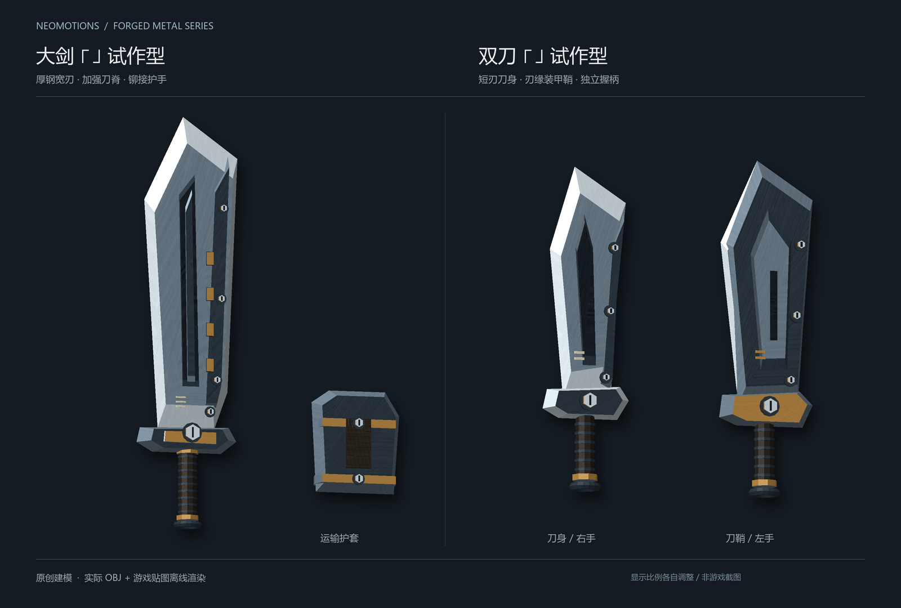
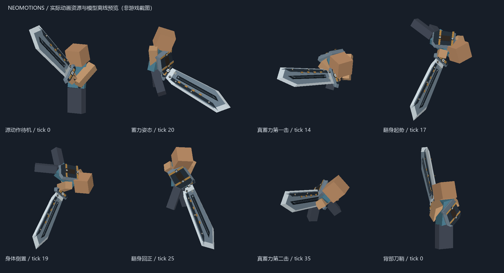
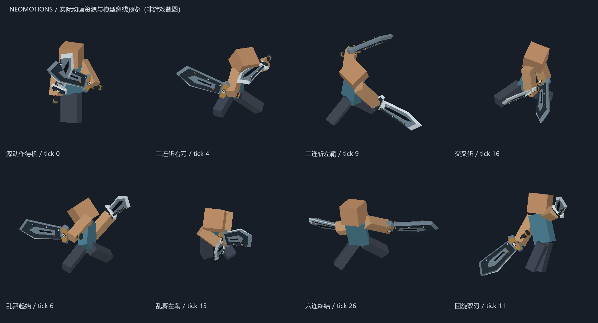

# SlashBlade: NeoMotions

[SlashBlade: Resharped](https://github.com/0999312/SlashBlade_Resharped) 的动作树附属模组。使用 **Stonecutter 共用源码 + Player Animator**，包含大剑、刀身／刀鞘双刀、斧剑变形斩斧三套动作树。当前版本 `0.5.0` 使用本地解包的 Wilds 大剑 `wp00`、双刀 `wp02`、斩斧 `wp08` 与变形组件 `wpg08` 骨架和动作制作动画，并从动作事件／USER 参数生成命中、取消、蓄力和过渡数据。真蓄力保留完整身体翻转。来源与适配边界见 [动画管线](docs/ANIMATIONS.md)。

完整操作、命中时间与衔接窗口见 [大剑与双刀出招表](docs/MOVESET.md)。新增 [斩斧操作与机制](docs/SWITCHAXE.md)。游戏内可悬停三本剑术手册查看精简三列出招表。

## 支持版本

| Minecraft | 加载器 | 拔刀剑本体 | Player Animator | 游戏运行 Java |
| --- | --- | --- | --- | --- |
| 1.20.1 | Forge 47.4.4 | 1.9.65（CurseForge 文件 8090912） | 1.0.2-rc1+1.20 | 17 |
| 1.21.1 | NeoForge 21.1.233 | 2.1.9-1.21.1（文件 9096556） | 2.0.4+1.21.1 | 21 |

客户端和服务端安装同一版本的本模组、SlashBlade: Resharped、Player Animator。两种加载器的 JAR 不能混用。当前不需要 GeckoLib。

## 三把试作型拔刀剑

新增三把本体命名刀，获得时即绑定专属 OBJ 模型、金属贴图和动作树：

| 名称 | 出厂动作树 | 基础攻击修正 | 耐久 | 初始 SA |
| --- | --- | --- | --- | --- |
| 大剑 ⌈⌋ 试作型 | 大剑 | 6 | 600 | 纵向剑气（drive_vertical） |
| 双刀 ⌈⌋ 试作型 | 双刀 | 4 | 400 | 回旋斩（circle_slash） |
| 斩斧 试作型 | 斧／剑双根 | 5 | 550 | R 用于变形与解放技 |

三把均带耐久 I，以满足本体 SA 的附魔条件。基础攻击修正不是最终伤害，仍由本体属性和动作倍率计算。可从创造模式的**拔刀剑分页、战斗栏或搜索栏**获取，或执行：

```text
/neomotions blade greatsword
/neomotions blade dualblade
/neomotions blade switchaxe
```

它们使用本体 `slashblade:slashblade` 物品承载独立的命名刀定义；不能直接用 `/give slashblade_neomotions:greatsword_prototype` 获取。名字、模型和能力会随刀保存、同步，切换手册后恢复会回到该试作型的出厂动作树。

`ModContent` 在模组事件总线上填充 `slashblade_neomotions` 命名空间的刀定义，加入定义指定的分页及战斗栏，并处理本体已添加的重复条目。刀定义使用本体默认的 `slashblade:slashblade` 创造分页；datagen 会省略这个默认 `creativeGroup` 字段。更新 JAR 或重新编译后需要重启客户端，才能加载新的事件监听代码。

模型采用怪猎铁制武器的厚钢、铆钉、加强刀脊和缠绕握柄风格，为本项目原创建模。大剑配短运输护套；双刀的装甲刀鞘具有独立握柄和刃缘，绑定左手 `hardpointB`。斩斧的主轴、折叠剑刃和刀鞘斧头跟随源部件动画；模型及配方见 [斩斧说明](docs/SWITCHAXE.md)。三套均包括完整刀身、断刀、碎片和背包模型，无需额外安装 GeckoLib。



工作台配方（B＝本体拔刀剑，P＝耀魂铁锭）：

```text
大剑：I＝铁块         双刀：I＝铁锭，L＝皮革
 · I ·                I · I
 I B I                · B ·
 · P ·                L P L
```

三份配方使用本体 `slashblade:shaped_blade`，保留材料刀的耀魂、击杀数、精炼及兼容附魔。完整配方、解锁进度、刀定义均来自 Java datagen，见下文；不手工维护同名 JSON。

## 装备与切换

手册均为无序合成，也可从创造模式战斗栏取得：

| 手册 | 配方 |
| --- | --- |
| 大剑剑术手册 | 书 + 铁块 + 耀魂（`slashblade:proudsoul`） |
| 双刀剑术手册 | 书 + 铁剑 ×2 + 耀魂 |
| 斩斧剑术手册 | 书 + 铁斧 + 耀魂 |

一只手拿手册、另一只手拿拔刀剑，右键装备对应动作树；潜行右键恢复原来的动作树。手册不消耗。三种剑术可以反复切换，恢复操作始终返回这把刀最初的动作树。

动作树保存到每把刀，不会全局替换其他刀的 Combo。刀的模型、攻击属性和原有 SA 设置保留。

## 操作

[完整出招表](docs/MOVESET.md) 包含两套动作的输入、衔接、命中 tick 和原作片段编号。

- 大剑：L 普通连段；按住 R 蓄力、松 R 出刀。蓄力斩后可提前按住 R，进入强蓄力、真蓄力。蓄力中重新按潜行可肩撞，点 L 后松 R 释放原有 SA。
- 双刀：L 连段；潜行＋L 回旋，潜行＋W＋L 突进，潜行＋S＋L 上挑。R 蓄满后松开释放 SA。左手使用本模型的刀鞘。
- 斩斧：R 变形（变剑要求斩击槽≥30）；L 主连段，潜行＋L 副连段，潜行＋R 螺旋充填／解放斩。剑命中积累觉醒，满槽获得 45 秒高输出。详见 [斩斧出招表](docs/SWITCHAXE.md)。
- 大剑蓄力在 16／31／46 tick 达到 Lv.1／2／3，60 tick 过蓄回到 Lv.2 并自动释放；SA 预备到时取消。

51 对 JSON/VMD 全部来自选定原作片段的重定向。身体、腿部、刀和刀鞘共用时间轴；第三人称武器直接绑定实际手腕，大剑刀鞘固定于背部。SA、按键映射、伤害倍率和简化连段属于 Minecraft 适配，未实现原作全部鬼人槽、耐力、集中模式与可执行文件内的完整状态机。

## 指令

管理员也可主手持刀执行：

```text
/neomotions style greatsword
/neomotions style dualblade
/neomotions style switchaxe
/neomotions style restore
/neomotions manual greatsword
/neomotions manual dualblade
/neomotions manual switchaxe
```

`/neomotions help` 不要求管理员权限。

## 当前招式信息配置

在游戏实例的 `config/slashblade_neomotions-client.toml` 中设置：

```toml
[hud]
showMoveInfo = false
showWeaponGauges = true
```

此选项默认关闭，仅影响本客户端。改为 `true` 后，在原蓄力提示的快捷栏上方位置显示当前大剑／双刀／斩斧招式、准备／攻击／收招／可衔接阶段及动作进度。蓄力时显示等级和计时，SA 预备时显示技能名、蓄力进度和精准窗口。待机、肩撞、空中及落地状态也包含名称；本体提供的后续动作标为“本体特殊动作”。

斩斧双槽 HUD 独立由 `showWeaponGauges` 控制，默认显示。原来的自动蓄力／SA 文字提示已合并到 `showMoveInfo` 开关。关闭时不显示这些持续状态文字；蓄力音效和粒子仍按招式逻辑触发。配置由加载器生成并读取，两个加载器使用同一文件名；示例见 [client-config.example.toml](docs/client-config.example.toml)。

## 构建与运行

构建使用 Gradle Wrapper 9.5.0。启动 Wrapper 的 `JAVA_HOME` 需要 Java 17 或更高版本；项目通过 `gradle/gradle-daemon-jvm.properties` 自动选择或下载 JDK 25 来运行 Gradle（ModStitch 0.8.5 要求 Java 25）。即使终端默认使用 Java 19，也无需手动切换即可运行。编译与游戏运行仍分别使用 Java 17（Forge）和 Java 21（NeoForge）的 toolchain。首次构建需要联网获取依赖。

若遇到 `Dependency requires at least JVM runtime version 21` 或 `25`，请确认项目包含上述 daemon 配置，并重新加载 IDE 的 Gradle 项目。运行 `.\gradlew.bat --version` 时，`Daemon JVM` 应显示项目配置的 Java 25。JDK 解析插件采用 Foojay 1.0.0，以兼容 Gradle 9；不要退回 0.8.x。

在项目根目录运行 PowerShell：

```powershell
.\gradlew.bat :1.20.1-forge:build :1.21.1-neoforge:build
```

可安装的产物位于：

```text
versions/1.20.1-forge/build/libs/slashblade_neomotions-forge-0.5.0+1.20.1.jar
versions/1.21.1-neoforge/build/libs/slashblade_neomotions-neoforge-0.5.0+1.21.1.jar
```

不要将 `-sources.jar` 当作模组安装。开发客户端：

```powershell
.\gradlew.bat :1.20.1-forge:runClient
.\gradlew.bat :1.21.1-neoforge:runClient
```

验证遵循 [AGENTS.md](AGENTS.md)：默认运行与修改有关的编译、离线预览和针对性测试。下面的完整服务器测试、客户端和 clean 构建按需使用，不作为每次修改的固定流程。自动测试示例：

```powershell
# 两版本的规则与动画资源解析测试
.\gradlew.bat :1.20.1-forge:test :1.21.1-neoforge:test

# 仅检查动作骨骼与握持，不启动游戏
.\gradlew.bat :1.20.1-forge:test --tests '*WeaponRigTest' :1.21.1-neoforge:test --tests '*WeaponRigTest'

# 需要运行时回归时，再执行两版本各 35 项服务器 GameTest
.\gradlew.bat :1.20.1-forge:runGameTestServer -PneomotionsGameTest
.\gradlew.bat :1.21.1-neoforge:runGameTestServer -PneomotionsGameTest

# GameTest 后打正式包前执行 clean；正式 JAR 另行排除测试类和测试结构
.\gradlew.bat :1.20.1-forge:clean :1.21.1-neoforge:clean :1.20.1-forge:build :1.21.1-neoforge:build
```

## 数据生成与建模

配方与刀定义的源码是 `platform/data/NeoMotionsRecipes.java` 和 `NeoMotionsData.java`，使用原生 `RecipeProvider`、本体 `SlashBladeShapedRecipeBuilder`、`RegistrySetBuilder` 和 `DatapackBuiltinEntriesProvider`。

```powershell
.\gradlew.bat :1.20.1-forge:runData :1.21.1-neoforge:runData
```

两节点分别输出到 `src/generated/1.20.1-forge/resources/`、`src/generated/1.21.1-neoforge/resources/`，自动参与该节点打包。每个节点生成 4 份配方、4 份解锁进度和 2 份命名刀定义；Forge 使用 `recipes/advancements`，NeoForge 使用 `recipe/advancement`。生成文件随源码保留，普通 build 无须再次启动 datagen；更改 Java 数据生成器后必须先运行 runData。`.cache` 不进入发布包。

命名刀 JSON 位于 `data/slashblade_neomotions/slashblade/named_blades/`。其中 `slashblade_neomotions` 是条目命名空间，`slashblade/named_blades` 是本体的数据注册表目录。当前本体允许附属模组在自己的命名空间中提供定义，无需另建同名数据注册表。

模型与纹理使用独立脚本重建，不参与数据包生成：

```powershell
python tools/generate_prototype_models.py
python tools/render_prototype_models.py
```

建模脚本生成 OBJ 和 256×256 金属 UV 图集；预览直接读取发布用 OBJ 与贴图进行光照、深度缓冲渲染，输出 `docs/images/prototype-models.png`。这张图不是游戏截图。动作资源的握持由实际播放器离线回归检查；实机镜头和交互观感的验证范围见验证记录。

## 代码结构与新增动作树

- `src/main/java/.../combat/GreatSwordMove.java`：20 个 Combo 状态的时长、连段窗口、命中时间、伤害倍率，包含三段 SA 预备。
- `combat/GreatSwordRules.java`：输入分支和蓄力规则，纯逻辑，可独立单测。
- `combat/GreatSwordStyle.java`：本体 ComboState 注册对象、服务端计时、伤害、肩撞、切换与恢复。
- `combat/DualBladeMove.java`、`DualBladeRules.java`、`DualBladeStyle.java`：12 个双刀状态、左右手命中时间表、分支和 SA。
- `combat/StyleSelection.java`：两套树共享的装备与恢复入口，保留原始 Combo root。
- `platform/`：本体能力/数据组件、Forge/NeoForge 事件和注册差异；Stonecutter 条件块集中处理这些差异。
- `platform/client/ClientAnimations.java`：订阅本体动作同步事件，为每名玩家创建独立的 Player Animator 播放器。
- `assets/slashblade_neomotions/player_animation/`：玩家动作 JSON。
- `assets/slashblade_neomotions/motions/`：本体刀模型使用的 VMD，与玩家动作使用同一时间轴。

增加其他动作树时，新增对应的 Move、Rules 和 Style，通过 `ModContent` 注册自己的 ComboState，并为其增加选择入口和客户端动画映射。不要覆盖本体注册 ID。当前共用的运行时依赖仅为本体和 Player Animator，没有 Mixin 或自定义网络通道。

根目录 `src/` 是编辑入口；`versions/*/build/generated/stonecutter/` 是生成目录。默认活动版本是 Forge 1.20.1。两套 Gradle 脚本分别对接 Loom 与 ModDevGradle，并由 Stonecutter 管理共用源码。

## 动画与验证状态

0.5.0 修复自有大剑／双刀第一人称与第三人称动作不一致：两视角使用同一个 Player Animator 播放器和武器握持变换，统一身体旋转轴心、左右手轨迹与分数 tick；保留 65% 缩放和下移 0.18。原生 SA 仍由本体第一人称渲染器处理。两节点各 28 项离线测试通过，未启动游戏客户端。

0.4.5 为双刀加入第一人称视野调整：右手刀身和左手刀鞘均缩小至 65%，下移 0.18 个渲染单位。普通、自发光和附魔闪光统一处理。

0.4.4 在两本剑术手册 Tooltip 中加入精简的“输入／招式／后续”三列表格，按实际字体宽度对齐；窄窗口自动换行并按可用高度缩放。手册与当前招式提示统一使用原作猎人笔记的简中／英文名称。

0.4.3 将原蓄力提示扩展为可选的当前招式信息，客户端 `hud.showMoveInfo` 默认关闭。开启后显示招式、阶段和进度，并包含蓄力与 SA 的原有详细信息。

0.4.2 修正大剑武器基底的 90° 映射错误，使切削刃迎向挥动方向，避免蓄力斩以宽刀面拍击。20 对大剑动作已重新生成；两节点各 26 项 JUnit 通过，新增实际播放器的刃向回归。

0.4.1 调整大剑第一人称显示：缩小到原来的 65%，并下移 0.18 个渲染单位，减少对视野中央的遮挡。第三人称和双刀保持原尺寸；本次只运行构建与已有离线回归。

0.4.0 包含 **20 套大剑状态和 12 套双刀状态，共 32 对 Player Animator JSON／VMD**，均由选定 Wilds 片段重定向。真蓄力采用片段 248 的完整翻身；双刀多段命中、地面根运动、蓄力阈值及衔接窗口读取解包数据。SA 释放后使用本体技能动作与效果。





两节点各 25 项 JUnit 通过，来源核对覆盖 1564 个根骨／腿部姿态。修复 Forge 所用 JOML 1.10.5 旋转转换错误，验证所有自有挥刀的刀光平面与方向、握持和背鞘。本轮没有启动游戏客户端或服务器 GameTest。第一人称镜头、碰撞后的步态与多人观感尚未实机验收；这些图为实际资源离线预览。

原始资源及早期实验转换留在 `.local`，不参与打包。生产流程、可重建命令和状态机适配边界见 [动画管线](docs/ANIMATIONS.md)，完整操作见 [出招表](docs/MOVESET.md)，详细检查范围见 [验证记录](docs/VALIDATION.md)。项目结构参考本机 `MC-Dev-Skills`。
