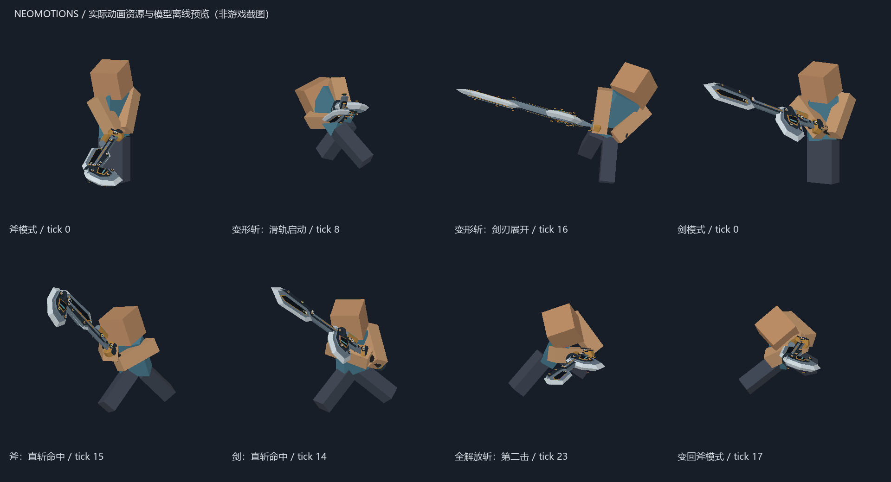

# 斩斧 · 0.5.0

斧、剑分别使用 `slashblade_neomotions:switchaxe_axe` 和 `switchaxe_sword` 两个树根。`斩斧 试作型` 出厂绑定斧树，三段机械模型使用同一右手挂点：主轴固定，刀鞘是滑动斧头，剑刃独立翻转。第一、第三人称共用 Player Animator 时间轴与组件矩阵。

## 操作

L＝左键，R＝右键，蹲＝潜行，前／后＝W／S。都从地面输入；连续输入需要到达源动作的衔接窗口。

| 输入 | 招式 | 后续 |
| --- | --- | --- |
| 斧＋L | 斧：直斩 | L → 横斩 → 螺旋充填斩 → 直斩 |
| 斧＋后＋L | 斧：抵消上捞斩 | L → 直斩 |
| 斧＋蹲＋L | 斧：挥舞 | L → 强化敲打；待机后可再次挥舞 |
| 斧＋蹲＋前／后＋L | 斧：突进直斩／后撤斩 | L 接主连段 |
| 斧＋蹲＋R | 斧：螺旋充填斩 | 命中回复斩击槽 |
| 斧＋R，槽≥30 | 斧：变形斩 | 进入剑树；L → 右上捞斩 |
| 剑＋L | 剑：直斩 | L → 右上捞斩 → 左上捞斩 → 直斩 |
| 剑＋蹲＋L | 剑：二连斩 | 蹲＋L → 飞天连击；飞天后 L → 右上捞斩 |
| 剑＋蹲＋R，槽≥20 | 压缩解放斩 | 结束回斧；L → 螺旋充填斩 |
| 剑＋高输出＋蹲＋R，槽≥35 | 全解放斩 | 结束回斧；L → 螺旋充填斩 |
| 剑＋R | 剑：变形斩 | 无最低槽限制，回斧；L → 螺旋充填斩 |

高输出时槽不足 35 但达到 20，蹲＋R 使用压缩解放斩。剑攻击连最低消耗都不足时转为变斧；恰好耗尽时先完成当前动作，到源衔接点后变斧。斩斧的 R 用于变形，不沿用大剑／双刀的原生 SA 蓄力输入。物品原有 SA 数据保留。

游戏内悬停「斩斧剑术手册」可查看对齐的精简出招表。斩击槽／觉醒槽 HUD 默认显示，`[hud].showWeaponGauges=false` 可关闭；当前招式文字仍由默认关闭的 `showMoveInfo` 单独控制。

## 槽机制

- 每把刀独立保存斩击槽、觉醒槽、高输出及斧强化剩余时间。初始斩击槽 100、觉醒槽 0；100 容量及逐招收支是 Minecraft 平衡参数。
- 原作阈值：变剑至少 30；斧模式／未持握时每 40 tick 回复 3。变形门槛不是额外扣除 30，变剑动作本身消耗 5。
- 剑命中积累觉醒；挥空不会增长。同一伤害脉冲命中多只怪只计一次槽增长。使用本体 HitEvent 和对应刀光命中列表共同确认。
- 未激活的觉醒槽每 80 tick 降 2；满槽进入 900 tick（45 秒）高输出，并回复 30 点斩击槽。高输出期间继续攻击不会刷新持续时间，到期清空觉醒槽。
- 高输出的已命中目标额外受到瓶伤害和粒子反馈，不破坏方块。这里的瓶伤害数值及伤害类型为 Minecraft 适配。
- 强化敲打第二击后进入 45 秒斧强化，斧攻击的槽回复乘 1.2。
- 槽值由服务端更新，使用物品 NBT／Data Components 经原版物品同步。切刀、换招、死亡或登出会清理未完成动作和刀光；槽不靠客户端计数，也不因切换快捷栏重置。

| 动作 | 启动消耗 | 每次确认命中：觉醒／斩击槽 |
| --- | --- | --- |
| 剑直斩、左右上捞 | 4 | 10／0 |
| 二连斩 | 7 | 9／0，最多两次 |
| 飞天连击 | 10 | 14／0，最多两次 |
| 变剑 | 5 | 10／0 |
| 变斧 | 0 | 0／5 |
| 压缩解放斩 | 20 | 16／0 |
| 全解放斩 | 35，须高输出 | 0／0；保留高输出瓶伤害 |
| 斧普通攻击 | 0 | 0／2–4 |
| 螺旋充填斩 | 0 | 0／10，最多两次 |

## 数据和适配边界

读取本机 Wilds 最新覆盖 PAK 中的 `wp08_00.motlist.992`（408 个片段）以及 `wpg08_00.motlist.992`（42 个变形组件片段）。发布 19 个选定状态；人物与武器部件都经过源骨架采样、坐标转换、刚性双臂握柄约束和 20 Hz 时间量化，没有另编手工挥刀关键帧。

`actionguidedata_wp08` 的 `_Action → _TransitionAction` 与输入记录导出到 manifest；主连段直接读取导出的 `primaryNext`。`wp08_00_mct` 提供过渡时间；CLIP 的碰撞开关、取消窗口和 `WeaponStateMotionID` 提供伤害窗口与变形提交帧。变剑在源第 67 帧（tick 23）提交，变斧在第 49 帧（tick 17）提交。解放技回斧采用源斧模式衔接窗口，是本模组的提交时点适配。

槽阈值、回复／衰减间隔、高输出／斧强化时间来自 `wp08globalactionparam`，原字段和值保存在 `source_actions.json.switchaxe.parameters`。逐招伤害、消耗、增长量、输入映射、二选一解放快捷键、碰撞移动限幅是 Minecraft 适配。剑右上捞和斧上捞的单脉冲落点会选择同一原始碰撞窗口内刃向领先的相邻帧；原始接触帧仍保留。

这是地面核心动作树与双槽机制的迁移，不是完整可执行文件状态机的复刻。装填、空中分支、零距离攀附、集中伤口及原作怪物抵消反应未迁移；「抵消上捞斩」当前保留原作动作与普通攻击判定。所有招式名保留原作名称，去掉原文末尾制表符；MSG GUID、中文与英文条目见 [名称来源](switchaxe-name-sources.json)。

## 试作型与 datagen

`斩斧 试作型` 为本项目原创金属模型：钢刃、深色滑轨、铆钉、黄铜锁扣与瓶室。没有复制原作武器网格或贴图。主轴为 `blade_core`，刀鞘组件为 `sheath`，折叠剑刃为 `blade_edge`；断刃、携带、背包模型也已制作。

- 基础攻击修正 5、耐久 550、耐久 I。
- 创造模式：拔刀剑分页、战斗栏、搜索栏。
- 获取：`/neomotions blade switchaxe`；手册：`/neomotions manual switchaxe`。
- 直接装备：`/neomotions style switchaxe`；手册仍使用一手手册、另一手拔刀剑的方式。
- 手册合成：书＋铁斧＋耀魂。
- 刀合成：下面 B 为本体拔刀剑，I 铁块，A 铁斧，R 红石，P 耀魂铁锭。

```text
· I A
· B ·
R P R
```

Java datagen 为每个节点新增 5 份数据：刀定义、两个配方和两个解锁进度。刀定义位于 `data/slashblade_neomotions/slashblade/named_blades/switchaxe_prototype.json`，由本体动态注册表加载。



## 可复用的重建流程

```powershell
python tools/extract_wilds.py --game F:/SteamLibrary/steamapps/common/MonsterHunterWilds --paths tools/wilds-switchaxe-paths.txt --output .local/wilds/switchaxe
python tools/read_wilds_rsz.py .local/wilds/switchaxe
python tools/retarget_source_actions.py --weapon sa
python tools/generate_prototype_models.py
.\gradlew.bat :1.20.1-forge:runData :1.21.1-neoforge:runData
.\gradlew.bat :1.20.1-forge:build :1.21.1-neoforge:build
```

`weapon_components.py` 将独立武器骨架相对 Grip 的变换转成 OBJ 部件轨道，`WeaponPose.component` 在两个视角中采样同样的轨道；VMD 的 hardpointB 同步输出斧头挂点。后续变形武器可以复用这一套部件流程，再增加武器配置与动作映射。原始数据和第三方 schema 留在 `.local`，不打包。

## 当前采样表

| 招式 | 源片段 | 时长 tick | 命中 tick | 常规衔接 tick |
| --- | --- | --- | --- | --- |
| 斧模式 | 0 | 68 | — | 0 |
| 剑模式 | 20 | 68 | — | 0 |
| 斧：直斩 | 360 | 48 | 15 | 30 |
| 斧：横斩 | 361 | 44 | 14 | 20 |
| 斧：抵消上捞斩 | 362 | 54 | 11 | 25 |
| 斧：突进直斩 | 371 | 58 | 22 | 27 |
| 斧：后撤斩 | 369 | 42 | 11 | 27 |
| 斧：挥舞 | 365 | 28 | 5, 18 | 4 |
| 斧：强化敲打 | 368 | 68 | 15, 27 | 44 |
| 斧：螺旋充填斩 | 372 | 60 | 16, 27 | 35 |
| 斧：变形斩 | 381 | 58 | 17 | 27 |
| 剑：变形斩 | 540 | 48 | 17 | 23 |
| 剑：直斩 | 510 | 42 | 14 | 19 |
| 剑：右上捞斩 | 525 | 48 | 15 | 22 |
| 剑：左上捞斩 | 526 | 34 | 8 | 19 |
| 剑：二连斩 | 515 | 56 | 16, 25 | 32 |
| 剑：飞天连击 | 517 | 78 | 24, 37 | 45 |
| 压缩解放斩 | 535 | 102 | 18 | 46 |
| 全解放斩 | 536 | 108 | 13, 23 | 52 |
